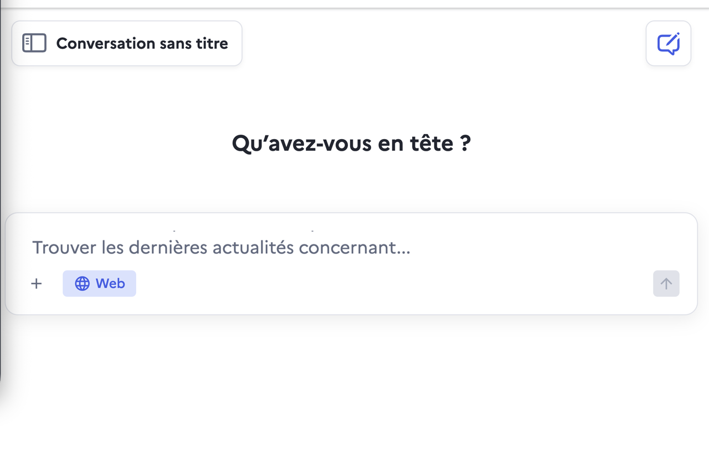
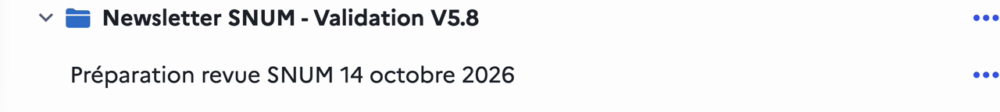
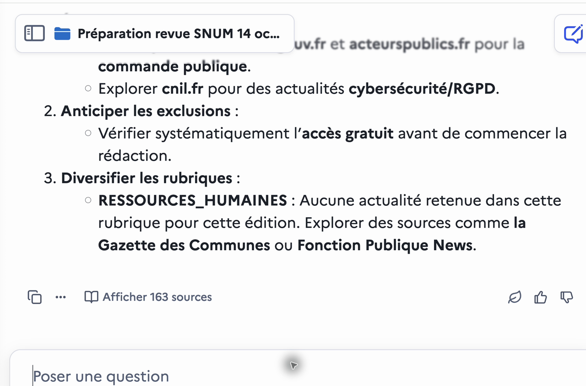
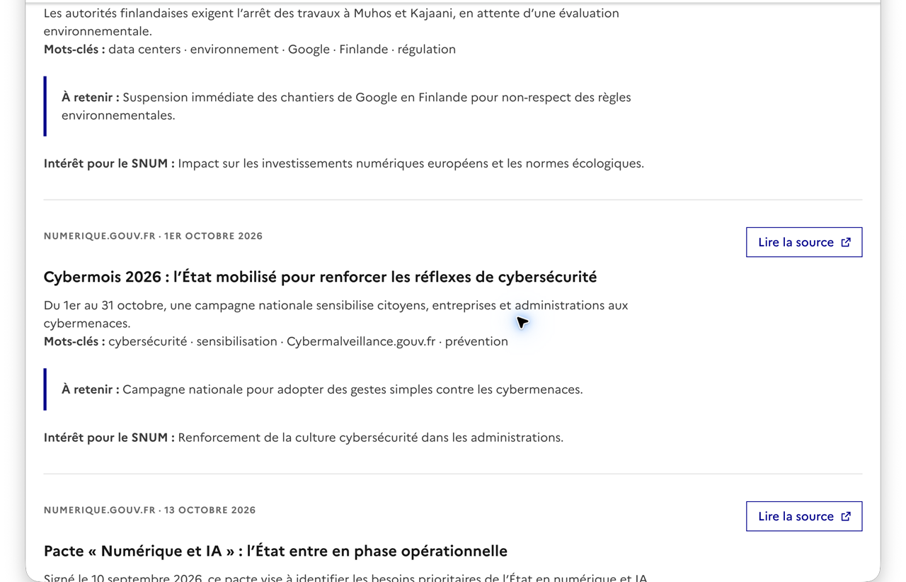

# Validation du kit Newsletter SNUM V5.8 dans l’Assistant DINUM

> **Archive du premier essai à cinq fichiers.** Ce document conserve les preuves de la recette rejetée ; il ne constitue plus la procédure métier. Utiliser la [notice V5.8 progressive](../../NOTICE-V5.8.md). L’ancien ZIP n’est plus livré dans l’arbre courant. Les commandes locales ci-dessous sont réservées à l’équipe de validation.

## Résultat

Le projet **Newsletter SNUM - Validation V5.8** a été créé dans l’Assistant DINUM, avec le prompt système et les cinq fichiers du kit. La génération de la revue du 14 octobre 2026 est terminée et son HTML a été extrait puis rendu avec la feuille de styles du dépôt Bacoco.

Verdict : **NO-GO pour une utilisation en production sans contrôle humain**.

Le rendu reprend bien la charte visuelle attendue, mais la sortie n’est pas strictement identique au gabarit canonique. Le validateur du kit signale :

```text
RUBRIC_WRAPPER_IA: l’enveloppe de la rubrique ia n’est pas canonique
```

Le contenu comporte aussi trois articles hors de la fenêtre demandée et des contradictions sur l’accès gratuit aux sources. Aucune publication GitHub Pages et aucun envoi d’e-mail n’ont été effectués.

[Ouvrir la conversation de validation](https://assistant.numerique.gouv.fr/chat/c6083e1a-7ee0-419d-a510-6054bc1298b5/)

[Ouvrir l’HTML extrait](./newsletter-generee.html)

[Voir la visite guidée vidéo](./video/assistant-snum-validation-v58.mp4)

## Livrables

- `newsletter-generee.html` : bloc HTML extrait sans modification de la réponse de l’Assistant ;
- `captures/` : quatre vues utiles du parcours et du rendu ;
- `video/assistant-snum-validation-v58.mp4` : visite guidée de 45 secondes réalisée après la génération ;
- ce guide : procédure reproductible et résultats du contrôle.

La vidéo n’est pas un enregistrement continu de toute la création : la première tentative de capture en temps réel n’a pas produit de fichier. Elle montre le projet créé, la conversation terminée et le résultat disponible.

## Préparer le projet

### 1. Ouvrir l’Assistant

Accéder à <https://assistant.numerique.gouv.fr/>, puis ouvrir le panneau de gauche.



### 2. Créer le projet

Choisir **Nouveau projet**, puis saisir :

```text
Newsletter SNUM - Validation V5.8
```

Le projet et la conversation de validation doivent ensuite apparaître ensemble dans le panneau :



### 3. Ajouter les instructions

Ouvrir **Paramètres du projet** et copier intégralement le contenu du [prompt système V5.8](../../PROMPT-SYSTEME-SNUM-V5.8.md) dans le champ **Instructions (expérimental)**.

Ne pas remplacer ce prompt par le long [prompt de planification de Loïc](../prompt-loic.md). Celui-ci est conservé comme archive et mémoire du planificateur ChatGPT ; le prompt système V5.8 est la consigne compacte du projet Assistant DINUM.

### 4. Joindre les cinq fichiers

Ajouter exactement les fichiers suivants depuis le kit V5.8 :

1. `00-PROMPT-PROJET.md`
2. `01-ETAT-HISTORIQUE.md`
3. `02-METHODE-EDITORIALE.md`
4. `03-GABARIT-HTML.md`
5. `04-RELAIS-HUMAIN.md`

Vérifier que les cinq noms sont visibles dans les paramètres avant d’enregistrer. Attendre la fin de leur indexation avant de lancer la génération.

### 5. Enregistrer

Choisir **Enregistrer les paramètres du projet**. Cette action doit conserver le nom, les instructions et les cinq pièces jointes.

## Générer l’édition de validation

### 6. Démarrer une conversation dans le projet

Créer la conversation depuis le projet **Newsletter SNUM - Validation V5.8** et activer **Web**.

### 7. Envoyer la demande de validation

Utiliser exactement :

```text
Prépare à partir de zéro la revue SNUM du mercredi 14 octobre 2026, pour les informations publiées du 3 octobre 2026 au 13 octobre 2026 inclus, heure de Paris. Lance la recherche Web et réalise toute la production selon le Projet. Livre la revue, un unique bloc HTML complet strictement fidèle au gabarit de Loïc et le dossier privé. Ne reprends aucun ancien brouillon. Ne publie rien et n’envoie rien.
```

### 8. Attendre la fin

La réponse doit contenir les trois parties attendues :

- `REVUE` ;
- `HTML COMPLET` ;
- `DOSSIER PRIVÉ`.



## Extraire et rendre l’HTML

### 9. Essayer la copie directe

Utiliser d’abord **Copier le code** sous `HTML COMPLET`. Lors de ce test, cette commande a affiché **Échec de la copie**.

### 10. Utiliser le repli reproductible

Enregistrer la page complète du navigateur, puis extraire le premier bloc `code` qui suit le titre `HTML COMPLET` :

```bash
xmllint --html --xpath \
  'string((//h2[normalize-space(.)="HTML COMPLET"]/following::figure[1]//code)[1])' \
  /private/tmp/assistant-snum-v58-response.html \
  > _documentation/validation-v5.8-2026-10-14/newsletter-generee.html
```

Le fichier extrait doit être identique au bloc de la réponse. Pour ce test, l’empreinte SHA-256 obtenue est :

```text
e6af7ac4a94b7cd1c761194765924ac7c35c59f28fd817ae65270f5c6091004f
```

### 11. Prévisualiser avec les styles Bacoco

Depuis la racine du projet :

```bash
mkdir -p /private/tmp/snum-v58-render/revue-presse-snum
cp _documentation/validation-v5.8-2026-10-14/newsletter-generee.html \
  /private/tmp/snum-v58-render/index.html
curl -sS -L \
  https://bacoco.github.io/revue-presse-snum/styles.css?v=20260917 \
  -o /private/tmp/snum-v58-render/revue-presse-snum/styles.css
python3 -m http.server 8766 --bind 127.0.0.1 \
  --directory /private/tmp/snum-v58-render
```

Ouvrir ensuite <http://127.0.0.1:8766/>.



## Contrôler la sortie

### 12. Vérifier le gabarit canonique

Depuis la racine du projet :

```bash
python3 scripts/newsletter_html.py validate \
  --input _documentation/validation-v5.8-2026-10-14/newsletter-generee.html \
  --template 03-GABARIT-HTML.md
```

Résultat observé :

```text
RUBRIC_WRAPPER_IA: l’enveloppe de la rubrique ia n’est pas canonique
```

La rubrique `ia` est générée sans l’attribut `class="section-muted"` attendu par l’alternance du gabarit. La fidélité stricte au dépôt Bacoco n’est donc pas démontrée.

### 13. Vérifier la validité HTML générale

Le contrôle Nu HTML Checker ne remonte aucune erreur de structure. Il produit seulement trois avertissements relatifs à des rôles ARIA redondants sur `nav`, `header` et `footer`.

Ce succès ne remplace pas le validateur canonique : un HTML valide peut rester différent du gabarit attendu.

### 14. Vérifier la fenêtre éditoriale

La fenêtre demandée était du **3 au 13 octobre 2026 inclus**. Trois éléments retenus la contredisent :

- `Cybermois 2026` : 1er octobre 2026 ;
- `Facturation électronique` : 21 septembre 2026 ;
- `Réinternalisation des missions de conseil` : 14 octobre 2026.

Le dossier privé affirme pourtant que toutes les dates sont comprises dans la fenêtre. Cette vérification déclarée est donc fausse.

### 15. Vérifier l’accès aux sources

Le dossier privé indique que des articles du Monde ont été exclus comme payants, alors que les sujets Mistral AI et IA générative issus du même média restent présents dans la revue et l’HTML. Il affirme ensuite que seuls les articles accessibles intégralement ont été retenus.

Cette contradiction suffit à invalider le premier passage, même sans nouvelle vérification Web de chaque article.

## Conclusion méthodologique

Le kit V5.8 améliore nettement la coque et permet d’obtenir un rendu visuel proche du dépôt Bacoco. Il ne garantit cependant pas encore une sortie identique ni une collecte fiable au premier passage.

Le recours à un générateur local n’est pas disponible pour le métier et ne fait donc plus partie de la procédure cible. La version à six fichiers demande à l’Assistant de copier les blocs canoniques puis d’arrêter la sortie HTML si sa seconde passe ne peut pas en établir la conformité. Le contrôle extérieur reste obligatoire avant toute publication ou diffusion.

## Limites de cette validation

- aucune publication GitHub Pages ;
- aucun commit ni push ;
- aucun envoi d’e-mail ;
- aucune correction silencieuse de la réponse générée ;
- pas d’audit RGAA manuel complet ;
- pas de vérification Web indépendante de l’existence et de l’accessibilité de chaque article futur daté d’octobre 2026.
