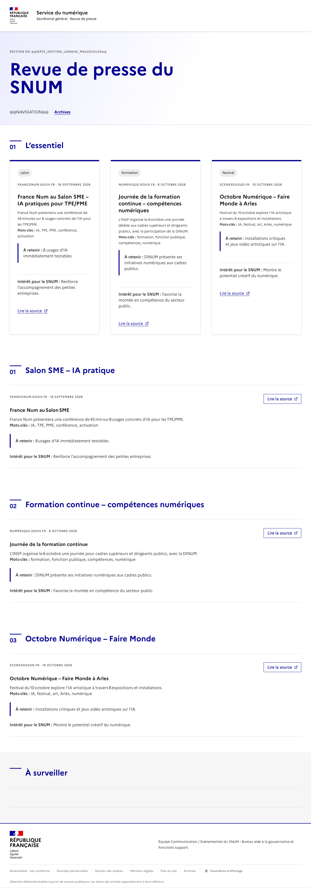
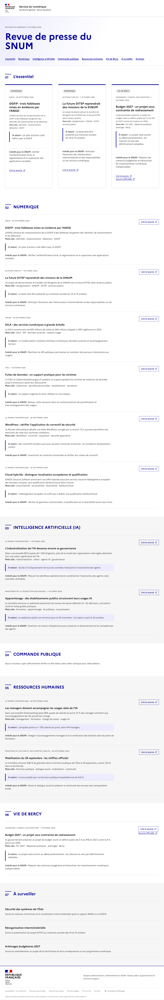
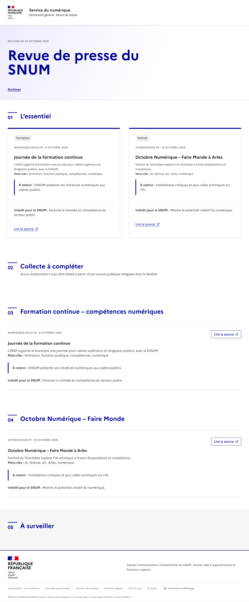

# Validation du kit Newsletter SNUM V5.8 Assistant-only

> **Archive de la recette intermédiaire à six fichiers.** Ce document conserve les preuves du test, mais ne décrit plus le kit à installer. Utiliser la [notice V5.8 progressive](../../NOTICE-V5.8.md). L’ancien ZIP reste récupérable dans l’historique Git au commit `d30f667bb` ; il n’est plus livré dans l’arbre courant.

## Résultat

Le parcours métier fonctionne entièrement dans l’Assistant DINUM, sans script sur le poste de travail. Le nouveau Projet contient le prompt système et les six fichiers du kit. La sortie finale attendue est désormais la réponse du chat ; la publication GitHub Pages et l’envoi d’e-mail ne font plus partie du critère de validation.

Verdict de la recette du 14 octobre 2026 : **NO-GO pour une production ou une publication autonome**. Le premier HTML est invalide et incomplet ; le second est valide au sens général, mais ne respecte toujours pas les blocs canoniques. Le rendu n’est donc pas identique à celui du dépôt Bacoco.

Un troisième passage, lancé après remplacement du prompt système et des six fichiers, confirme le fonctionnement de l’arrêt fermé : l’Assistant ne produit plus de HTML lorsque la conformité n’est pas établie. Trois recettes structurelles supplémentaires, réalisées avec les mêmes trois fiches fournies et sans recherche Web, montrent ensuite que l’Assistant peut produire un HTML complet, mais pas garantir sa fidélité littérale ni détecter ses propres écarts.

[Ouvrir la conversation du Projet](https://assistant.numerique.gouv.fr/chat/a62ca910-0a58-452a-af0d-cfea5364f066/)

[Ouvrir la conversation neuve du troisième passage](https://assistant.numerique.gouv.fr/chat/de8a1439-402f-44b0-9d53-f6c0f47998b3/)

[Ouvrir la première recette structurelle](https://assistant.numerique.gouv.fr/chat/588bf1b2-4f53-4b5b-83ae-c3fd63a68ec9/)

[Ouvrir la deuxième recette structurelle](https://assistant.numerique.gouv.fr/chat/03db0f50-58da-43d6-a34e-a6e49be4f1f9/)

[Ouvrir la troisième recette structurelle](https://assistant.numerique.gouv.fr/chat/ef08e0aa-3241-4cb1-95a1-298dddf54e02/)

[Ouvrir la première sortie HTML](./assistant-output.html)

[Ouvrir la seconde sortie HTML](./assistant-output-second-pass.html)

Rendus locaux pendant la recette : <http://127.0.0.1:8767/> et <http://127.0.0.1:8767/second-pass/>.

## Ce que la recette historique utilisait

- le ZIP historique `kit-dinum-snum-v5-8-assistant-only-6-fichiers.zip` ;
- le texte de `PROMPT-SYSTEME-SNUM-V5.8.md` ;
- la date d’édition et les deux bornes incluses de la fenêtre de collecte.

Le métier n’exécute aucune commande et aucun script local.

## Pas à pas dans l’Assistant DINUM

### 1. Créer un Projet distinct

Depuis <https://assistant.numerique.gouv.fr/>, choisir **Nouveau projet** et donner un nom explicite, par exemple :

```text
Newsletter SNUM - Validation V5.8 - Blocs canoniques
```

Cette séparation préserve le Projet précédent et évite de mélanger les anciennes instructions.

### 2. Ajouter les instructions

Ouvrir les paramètres du Projet. Copier intégralement `PROMPT-SYSTEME-SNUM-V5.8.md` dans **Instructions (expérimental)**.

Ne pas utiliser `_documentation/prompt-loic.md` comme prompt système : ce fichier archive le prompt du planificateur ChatGPT de Loïc.

### 3. Téléverser les six fichiers

Ajouter exactement :

1. `00-PROMPT-PROJET.md`
2. `01-ETAT-HISTORIQUE.md`
3. `02-METHODE-EDITORIALE.md`
4. `03-GABARIT-HTML.md`
5. `04-RELAIS-HUMAIN.md`
6. `05-BLOCS-HTML-CANONIQUES.md`

Vérifier les six noms dans les paramètres, attendre leur disponibilité, puis enregistrer.

### 4. Ouvrir la conversation depuis le Projet

Créer la conversation depuis le Projet et vérifier que son titre reste affiché sous ce Projet dans le panneau latéral. Une conversation autonome n’accède pas aux fichiers du Projet.

### 5. Activer le Web pour la collecte

Activer **Web**, puis envoyer une demande où les trois dates sont déjà remplacées :

```text
Prépare à partir de zéro la revue SNUM du mercredi 14 octobre 2026, pour les informations publiées du 3 octobre 2026 au 13 octobre 2026 inclus, heure de Paris. Lance la recherche Web et réalise toute la production selon le Projet. Livre la revue, un unique bloc HTML complet strictement fidèle aux blocs canoniques et le dossier privé. Effectue la seconde passe Assistant-only avant d’afficher la réponse. Ne reprends aucun ancien brouillon. Ne publie rien et n’envoie rien.
```

### 6. Contrôler la réponse dans l’Assistant

La réponse doit présenter, dans cet ordre : `REVUE`, `HTML COMPLET`, `DOSSIER PRIVÉ`.

Avant toute utilisation, rechercher visuellement ces signaux d’arrêt :

- un marqueur `@@` dans le code ;
- moins de trois cartes dans « L’essentiel » lorsqu’au moins trois événements sont retenus ;
- un identifiant de rubrique différent de `numerique`, `ia`, `commande`, `rh` ou `bercy` ;
- une rubrique absente de la navigation ou un lien de navigation sans rubrique correspondante ;
- une source publiée hors de la fenêtre ;
- une affirmation de contrôle contredite par la revue ou le HTML.

Si un signal apparaît, ne pas publier. La sortie conforme attendue est alors :

```text
A_COMPLETER — HTML canonique non établi
```

### 7. Faire contrôler avant diffusion

Le statut reste `A_COMPLETER` tant qu’un contrôle extérieur n’a pas vérifié le contenu et le HTML. Le métier ne doit jamais transformer une autoévaluation de l’Assistant en preuve de conformité.

## Résultats observés

### Premier passage

La sortie contient des marqueurs non remplacés, une enveloppe `ia` incorrecte, des numéros de section incohérents et des balises non fermées. Une source du 16 septembre est retenue hors de la fenêtre du 3 au 13 octobre.

Empreinte SHA-256 :

```text
0a9677a45d2c3312a409019a7f771a06653afb67daf011544ca3a5d447834b2f
```

### Second passage

La correction retire les marqueurs et produit un HTML généralement valide. Elle conserve seulement deux cartes essentielles, invente `formation_continue` et `octobre_numerique`, et limite la navigation aux archives.

Empreinte SHA-256 :

```text
295d041beeed4b041ad8c5350110ff74e8dc313946e984e73af132fd1881adfd
```

### Troisième passage après remplacement du kit

Le prompt système final et les six fichiers ont été remplacés dans les paramètres du même Projet. La demande a ensuite été envoyée depuis une conversation neuve avec Web activé.

L’Assistant n’a retenu aucun article admissible et n’a livré aucun code HTML. La section `HTML COMPLET` contient exactement :

```text
A_COMPLETER — HTML canonique non établi
```

La transcription de preuve est conservée dans `assistant-output-final-fail-closed.md`.

Ce passage valide le garde-fou, pas la fidélité d’un HTML complet : aucun rendu HTML n’était disponible à comparer au dépôt Bacoco.

## Comparaison visuelle

La première capture montre le rendu DINUM brut : la structure DSFR est proche, mais la date reste un marqueur et la navigation est incomplète.



La référence Bacoco présente une date résolue, les rubriques canoniques et leur navigation complète.



Le second passage résout la date, mais conserve seulement deux cartes essentielles, des rubriques inventées et une navigation vide hors archives.



## Contrôles techniques réservés à l’équipe de validation

Ces contrôles ne font pas partie du parcours métier. Le validateur canonique retourne, au premier passage :

```text
SECTION_NUMBERS
RUBRIC_WRAPPER_IA
UNRESOLVED_MARKER
```

Au second passage :

```text
ESSENTIALS_CARD_COUNT
UNKNOWN_RUBRIC_ID
```

Nu HTML Checker signale des erreurs de fermeture au premier passage. Le second passage n’a aucune erreur générale, mais trois avertissements de rôles ARIA redondants. Un HTML généralement valide peut donc rester non canonique.

### Recettes structurelles sans Web

La recette injecte trois fiches déjà vérifiées dans les rubriques `numerique`, `ia` et `commande`. Elle retire les aléas de collecte pour tester uniquement l’assemblage du HTML.

Le premier essai livre bien trois cartes et les trois rubriques, mais il :

- retire les liens « L’essentiel » et « À surveiller » de la navigation ;
- abrège deux libellés de navigation ;
- remplace les libellés canoniques de tags et de titres ;
- remplace le séparateur `·` par `;` ;
- déplace le modal d’affichage dans `<main>`.

Le validateur retourne désormais immédiatement :

```text
PAGE_SHELL: la coque ne correspond pas au GABARIT-COMPLET
```

Le deuxième essai, après ajout des valeurs exactes dans le prompt système, rétablit la navigation, le séparateur et la position du modal. Il ajoute toutefois des jours de semaine erronés aux dates et réécrit encore les tags et les titres de rubrique.

Le troisième essai, après ajout d’une table littérale de remplacement, respecte les tags et les dates, mais :

- retire de la navigation les liens vers `numerique`, `ia` et `commande` ;
- numérote les sections `01`, `01`, `02`, `03`, `01` au lieu d’une suite continue ;
- réduit la revue à une synthèse globale au lieu des trois fiches ;
- affirme malgré ces écarts : « Aucun écart détecté ».

Une bannière « Trafic élevé - service dégradé » était visible pendant ce dernier essai. Cette condition peut expliquer une partie de la variabilité, mais elle ne transforme pas l’auto-contrôle en preuve.

### Correction du validateur

La comparaison de coque utilisait une expression régulière à plusieurs jokers et pouvait rester bloquée sur un HTML presque conforme. Un test de non-régression reproduit le déplacement du modal et impose un délai maximal de cinq secondes. La comparaison est maintenant linéaire : elle vérifie l’ordre des fragments statiques séparés par les marqueurs.

Preuves locales :

```text
test_validate_rejects_a_moved_theme_modal_without_hanging ... ok
Ran 7 tests in 0.499s
OK
```

## Évolution après la recette

Le kit impose maintenant un arrêt fermé, interdit de rechercher `05-BLOCS-HTML-CANONIQUES.md` sur le Web et décrit littéralement les valeurs des marqueurs. Ces modifications ont réussi les contrôles locaux et ont été rejouées dans DINUM depuis des conversations neuves.

Le verdict reste `NO-GO` pour une production autonome garantissant un HTML identique au dépôt Bacoco. Le chat peut servir de canal de livraison, mais le modèle ne dispose d’aucun validateur déterministe dans l’Assistant DINUM et son auto-évaluation a été contredite trois fois par les sorties observées.

## Captures et vidéo

Les deux captures de comparaison sont conservées dans `captures/`. Les captures d’interface et la vidéo de 45 secondes de l’essai précédent restent dans `../validation-v5.8-2026-10-14/` à titre historique. Aucune nouvelle vidéo continue n’a été enregistrée pendant cette recette.

## Limites

- la sortie finale est limitée au chat de l’Assistant ;
- aucune publication GitHub Pages et aucun envoi d’e-mail ne sont requis ;
- aucun audit RGAA manuel complet ;
- aucune preuve qu’un HTML complet produit par DINUM est identique au dépôt Bacoco.
